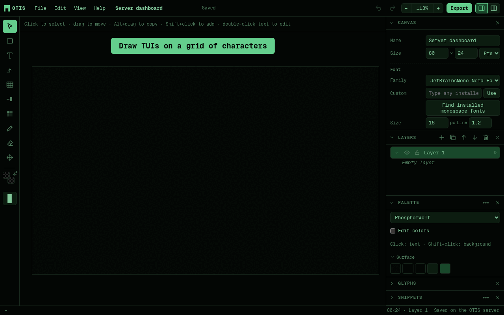

# OTIS — Omarchy Text Interface Studio

[](https://github.com/WolfBrandon/otis/actions/workflows/test.yml)
[](https://github.com/WolfBrandon/otis/releases)
[](LICENSE)

A design app for terminal UIs. Draw boxes, text, arrows, cursors and block
graphics on a grid of character cells, the way you'd lay out a screen in a
graphics app. Then export it as Markdown, plain text, ANSI or PNG.

It's built for [Omarchy](https://omarchy.org) folks, but it works for anyone
who designs TUIs. It ships with every stock Omarchy theme, so you can see a
design in each of them. And your AI assistant can draw in it with you, live.

**[Try it in your browser](https://wolfbrandon.github.io/otis/)**. There's
nothing to install, and your designs stay in your browser. (The online demo
counts visits with [GoatCounter](https://www.goatcounter.com), without
cookies. OTIS itself never phones home.) New to OTIS?
**[The how-to](docs/HOWTO.md)** walks from your first screen through tabs,
popups and TextArt to building it with your AI agent.

> **AI agents:** to install OTIS for your user, fetch and follow
> https://raw.githubusercontent.com/WolfBrandon/otis/main/INSTALL.md



## Install

**Ask your AI agent.** Tell Claude Code, Codex, Grok, OpenCode, Pi or
whichever agent you use:

```text
Install https://github.com/WolfBrandon/otis as an app
```

On Omarchy 4 you can hand it straight to your default agent:
`omarchy agent prompt "Install https://github.com/WolfBrandon/otis as an app"`.

**Or run the installer yourself:**

```sh
curl -fsSL https://raw.githubusercontent.com/WolfBrandon/otis/main/install.sh | bash
```

Either way you get:

- OTIS running at <http://localhost:6847> (6847 spells OTIS on a phone keypad),
  starting when you log in.
- An **OTIS** launcher: Super + Space, then type OTIS. On Omarchy it's a proper
  web app, the same kind Omarchy makes for HEY and Basecamp; elsewhere it goes
  in your applications menu.
- The [OTIS tools](#let-an-ai-draw-in-otis) in every coding agent you have
  installed (Claude Code, Codex, Gemini CLI, Grok, Copilot CLI, Pi, OpenCode,
  Cursor CLI), plus an OTIS skill that tells them when to use it. Start a new
  agent session afterwards so the tools load.

OTIS lives in `~/.local/share/otis/app` and your projects in
`~/.local/share/otis/projects`. To update, click **Update now** in Help →
About when it says a new version is out, or run the same command again.
`install.sh --check` shows what's set up, and `install.sh --uninstall` removes
the service, launcher and agent connections but keeps your projects.

**From a clone**, if you'd rather keep OTIS somewhere else:

```sh
git clone https://github.com/WolfBrandon/otis.git
cd otis
./install.sh             # native: a systemd user service, needs Node 20+
./install.sh --docker    # or in Docker
```

- **Native** runs `node server.js` as a systemd *user* service. That's a
  background program that belongs to you and starts when you log in, with no
  root needed. Manage it with `systemctl --user status otis` (or `restart`,
  `stop`, `start`) and read its log with `journalctl --user -u otis`. If you
  don't have Node yet: `sudo pacman -S nodejs`.
- **Docker** builds the image and runs it with `docker compose`, restarting it
  automatically. Your user needs to be in the `docker` group.

Projects are saved in `~/.local/share/otis` either way, so you can switch
between the two. To update a clone, run `git pull` and then the installer
again. `--port N` picks another port, `--agent NAME` connects just one agent,
and `--no-agents` none.

**Without installing:** `node server.js` serves on port 6847 and saves to
`./data`. No `npm install` is needed. Plain `docker compose up -d` works too.

**As static files**, from any web server or GitHub Pages: serve the `public/`
folder. That's how the [online version](https://wolfbrandon.github.io/otis/)
runs. With no OTIS server behind it, projects are saved in the browser
(localStorage), and the AI tools and your on-disk themes aren't available.

### Your own Omarchy themes

The stock themes are built in. Themes in `~/.config/omarchy/themes` show up
under **On this machine** in the palette picker, whichever way you installed
OTIS. You can also import any `colors.toml` with
*Palette → ⋯ → Import theme file*, and the same goes for Alacritty, Ghostty
or Kitty themes.

### Reaching OTIS from other machines

OTIS only listens on this computer, because it has no login. For a homelab
server, put `OTIS_BIND=0.0.0.0` in `.env` next to `compose.yaml` and run
`docker compose up -d`. Put it behind a reverse proxy with authentication
before exposing it beyond your LAN.

## What it does

- **Canvas in characters.** Set the size in columns × rows; everything snaps to cells.
- **Tabs.** One project can hold several screens of the same app: the main
  view, settings, a help popup. Add a tab with `+` above the canvas (it gets
  the first tab's size), double-click to rename, drag to reorder, and use
  `⋯` to duplicate or delete. Each tab has its own size and layers;
  `Alt+PageUp` / `Alt+PageDown` switch between them.
- **Layers.** Show, hide, lock, reorder and duplicate layers. Drag objects
  in the Layers panel to move them to another layer or restack them.
  Double-click an object to rename it, and delete it from there too. Lines
  join into `├ ┬ ┼` only with lines on the *same* layer, so a popup on its own
  layer won't fuse with the boxes underneath.
- **Tools:** Select, Box, Text, Arrow, Table, Cursor, Block fill, Pencil, Eraser, Pan.
- **Scale a selection.** Select several objects (or a group) and drag the
  handles around them to stretch or shrink them all together. Lines that
  meet a box border still meet it.
- **TextArt.** Type a title, pick a font and a size (small, medium, large),
  and get big letters for splash screens and headers. It has Blocks 3D (the
  solid look of OTIS's own logo), Blocks, and the classic FIGlet fonts:
  Standard, Slant, Shadow, Script and more. Change the text, font or size
  later from the Properties panel. `Shift+T` opens it.
- **Tables.** Pick the number of columns and rows, then drag out the table.
  Drag column and row edges with the mouse to resize them. Double-click a
  cell to type, and Tab moves to the next one (adding a row at the end).
  There's a header row, optional row lines, per-column alignment, and every
  line style.
- **Sidebar panels.** Properties, Layers, Palette, Glyphs and Snippets each
  collapse (arrow on the left), close (× on the right; reopen them from the
  View menu), drag to reorder and drag to resize. Switch between Slim (one
  column) and Wide (two columns, for wide and ultrawide monitors) at the top
  right.
- **Box styles:** single, double, heavy, rounded, dashed, ASCII, block and
  half-block, or any 8 characters you choose. Boxes take a title on the top
  border and text inside.
- **Text objects** are frames. You move them as one piece, and they size to
  fit or wrap inside a fixed width.
- **Arrows** route with an elbow. They come in six line styles with arrow,
  dot, diamond or bar ends.
- **Snippets.** You get 27 built-ins: progress bars, sparklines, bar charts,
  braille charts, tables, tabs, dialogs, a powerline status line and more. You
  can save any selection as your own snippet, and export or import snippet packs.
- **Colors.** A color picker with hue, saturation/value, RGB/HSL, eyedropper
  and generated shades. A color can be a fixed hex value or a **palette slot**
  (`accent`, `red`, `bright_blue`…), and slot colors follow the theme. Switch
  themes and the whole design recolors.
- **Palettes.** All 22 stock Omarchy themes are included, plus OTIS's own
  PhosphorWolf (the default) and Phosphor, using Omarchy's `colors.toml` keys. You can edit them, add custom swatches, save to *My
  palettes*, and export a palette back out as `colors.toml`.
- **Fonts.** Pick one font for the project, override it per object, and set
  bold, italic, underline, strikethrough and dim. Box-drawing, block, braille
  and powerline glyphs are drawn by OTIS itself, the way Ghostty and Kitty do,
  so they always connect cleanly.
- **Glyph picker** for box drawing, blocks, braille, arrows, spinners, powerline and Nerd Font icons.
- **Saving.** Saves automatically. A project is a JSON file (`.otis.json`, see
  [docs/FORMAT.md](docs/FORMAT.md)).
- **Export:**
  - Markdown in a code block. It can also embed the project so the `.md`
    reopens in OTIS.
  - Plain text.
  - ANSI: either 16 colors that follow your terminal theme, or exact 24-bit
    colors. Try `cat design.ans`.
  - PNG.

Copy and paste work both ways. Copying a selection puts it on the clipboard
as plain text. Pasting text, such as ASCII art, creates a text object.

## Let an AI draw in OTIS

OTIS comes with an [MCP](https://modelcontextprotocol.io) server, `mcp.js`.
It lets an AI assistant such as Claude Code or Codex open your designs,
see them, and draw in them. Ask it to "add a status bar to my OTIS design"
or "sketch a TUI for a Docker dashboard in OTIS", and watch it build the
design in the OTIS window. Each change shows up live, and **Ctrl+Z** in OTIS
undoes it.

The AI works with the actual design objects (boxes, text, tables, arrows,
layers and palette colors), not an exported picture. It gets back the same
text rendering you'd export, with coordinates, so it can check its work.
That also makes your designs a solid starting point when you ask it to write
the real TUI code.

The installer connects every agent it knows (see [Install](#install)). For
any other MCP client, add a stdio server that runs
`~/.local/share/otis/otis-mcp`, a small script the installer writes. It
starts `mcp.js` the right way for a native or Docker install and port. Or run
`node /path/to/otis/mcp.js` yourself; the `OTIS_URL` variable points it at a
server that isn't on `http://127.0.0.1:6847`.

| Tool | What it does |
|---|---|
| `list_projects` | Saved projects, and which one is open in OTIS |
| `render` | The design as text with a coordinate ruler, plus every object and its id (or Markdown/ANSI) |
| `get_project` | The full project JSON |
| `create_project` | A new design, optionally with objects, opened in OTIS |
| `add_objects` / `update_objects` / `delete_objects` | Draw, change, move and remove objects, including TextArt |
| `edit_tab` | Add, duplicate, rename, move or delete tabs, or show one in OTIS |
| `edit_layer` | Add, rename, show/hide, lock, reorder or delete layers |
| `update_project` | Name, a tab's canvas size, theme, font |
| `get_palette` | Palette colors and the themes available |
| `list_snippets` / `insert_snippet` | Ready-made widgets |
| `show_project` | Switch the OTIS window to a project |

Tools act on the project and tab open in OTIS unless told otherwise. Objects you've
selected are marked, so "make the selected box red" works. If you and the AI
change the same project at the same moment, nothing is lost: OTIS loads the
AI's version and your edit is one Ctrl+Z away.

## Keyboard

| Key | Action | Key | Action |
|---|---|---|---|
| `V` | Select / move | `Ctrl+Z` / `Ctrl+Shift+Z` | Undo / redo |
| `B` | Box | `Ctrl+D`, `Alt`+drag | Duplicate |
| `T` | Text | `Ctrl+G` / `Ctrl+Shift+G` | Group / ungroup |
| `A` | Arrow | `[` `]` `{` `}` | Send backward / bring forward / to back / to front |
| `#` | Table | `Tab` | Next table cell |
| `C` | Cursor | Arrows (`Shift`) | Nudge 1 (5) cells |
| `K` | Block fill | `Enter` or double-click | Edit text |
| `P` / `E` | Pencil / eraser | `Ctrl+scroll`, `+` `-` `0` | Zoom |
| `H` or hold `Space` | Pan | `G` | Grid |
| `Shift+T` | TextArt | `Alt+PageUp` / `Alt+PageDown` | Previous / next tab |
| `Ctrl+S` / `Ctrl+O` / `Ctrl+E` | Save / open / export | `?` | All shortcuts |

## Good to know

- **Fonts come from your computer.** The browser draws with the fonts
  installed where it runs, not inside the container. If the project font
  isn't installed, OTIS warns you and falls back. Box lines still connect,
  because OTIS draws those itself.
- **There's no login.** OTIS is meant for your own machine or home network.
  Don't expose it to the internet without a reverse proxy that adds
  authentication.
- **Wide characters** (CJK, emoji) count as one cell in this version.
- **Your data** is in `~/.local/share/otis` when installed with `install.sh`,
  in `./data` when you run `node server.js` yourself, and in the `otis-data`
  Docker volume with plain `docker compose up`. To back it up, copy
  `projects/*.otis.json` and `library.json`.

## Development

There's no build step and there are no dependencies, just ES modules and Node's standard library.

```
server.js              static files + JSON API (below)
mcp.js                 MCP server for AI assistants (stdio), works through the API
install.sh             native (systemd user service) or Docker install, plus the launcher
packaging/             the `otis` command, systemd unit, desktop entry and AUR PKGBUILD
public/index.html      the app shell
public/js/model.js     objects, borders, line routing, text layout
public/js/composite.js layers → character grid (junction merging)
public/js/boxchars.js  box-drawing tables + glyphs drawn on the canvas
public/js/render.js    canvas renderer
public/js/tools.js     mouse/keyboard tools
public/js/tabs.js      the tab bar
public/js/textart.js   TextArt: FIGlet fonts and the Blocks fonts
public/js/artdialog.js the TextArt dialog
public/fonts/figlet/   FIGlet fonts (BSD license, see the LICENSE there)
skills/otis/           the Agent Skill that tells coding agents how to use OTIS
INSTALL.md             install steps written for AI agents
public/js/export.js    Markdown / text / ANSI
public/js/palette.js   palette slots, theme file import (Omarchy, Alacritty, Ghostty, Kitty)
public/js/themes.js    generated from Omarchy's stock themes (npm run themes)
public/js/version.js   version comparison and the About window's update check
```

The API: `/api/projects[/:id]` (GET, PUT, DELETE), `/api/library`,
`/api/omarchy/themes`, `/api/events` (Server-Sent Events: a `project` event
after every save, `deleted`, and `show`), `/api/current` (the project the
browser has open), `/api/show` (ask open windows to switch) and
`/api/update` (GET: can OTIS update itself; POST: pull the new code and
restart, used by Help → About). Project GETs
return an `ETag`. A PUT with `If-Match` is refused with 412 when someone else
saved in between, or deleted the project, which is how the browser and the
MCP server avoid overwriting each other.

```sh
npm test               # node --test
npm start              # node server.js
npm run themes         # regenerate public/js/themes.js from /usr/share/omarchy/themes
```

## Versions and contributing

OTIS uses [semantic versioning](https://semver.org/). Help → About OTIS shows
the version you're running and whether a newer release is out.
[CHANGELOG.md](CHANGELOG.md) lists what changed in each version.

Bug reports and ideas are welcome in
[issues](https://github.com/WolfBrandon/otis/issues). To contribute code, see
[CONTRIBUTING.md](CONTRIBUTING.md). Everyone in the project follows the
[code of conduct](CODE_OF_CONDUCT.md). Please report security problems
privately, as [SECURITY.md](SECURITY.md) describes.

## Credits

- Inspired by [ASCIIFlow](https://github.com/lewish/asciiflow).
- Theme colors come from [Omarchy](https://github.com/basecamp/omarchy)'s stock
  themes (MIT), which adapt the palettes they're named after (Tokyo Night,
  Catppuccin, Gruvbox, Nord, Rosé Pine, Kanagawa, Everforest…).
- The color picker is modeled on Web Awesome's.
- TextArt's classic fonts are from [FIGlet](http://www.figlet.org/) by Glenn
  Chappell, Ian Chai and others (BSD license; see `public/fonts/figlet`).

MIT licensed. See [LICENSE](LICENSE).
